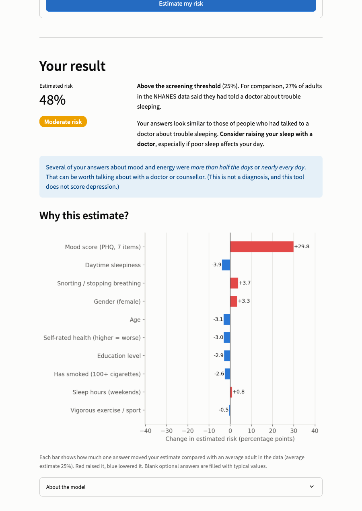
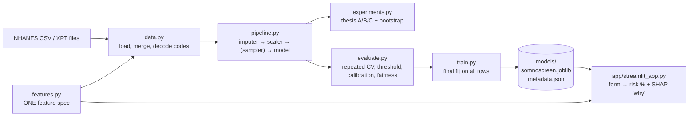
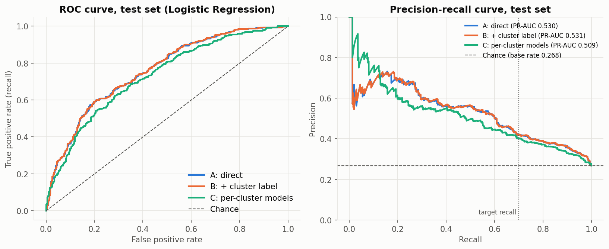
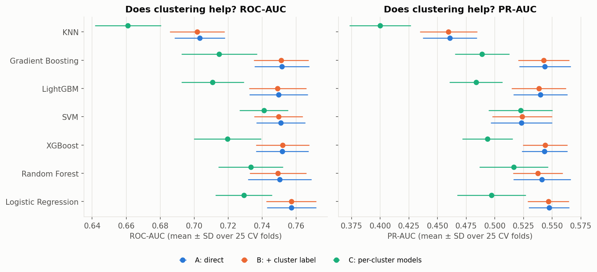
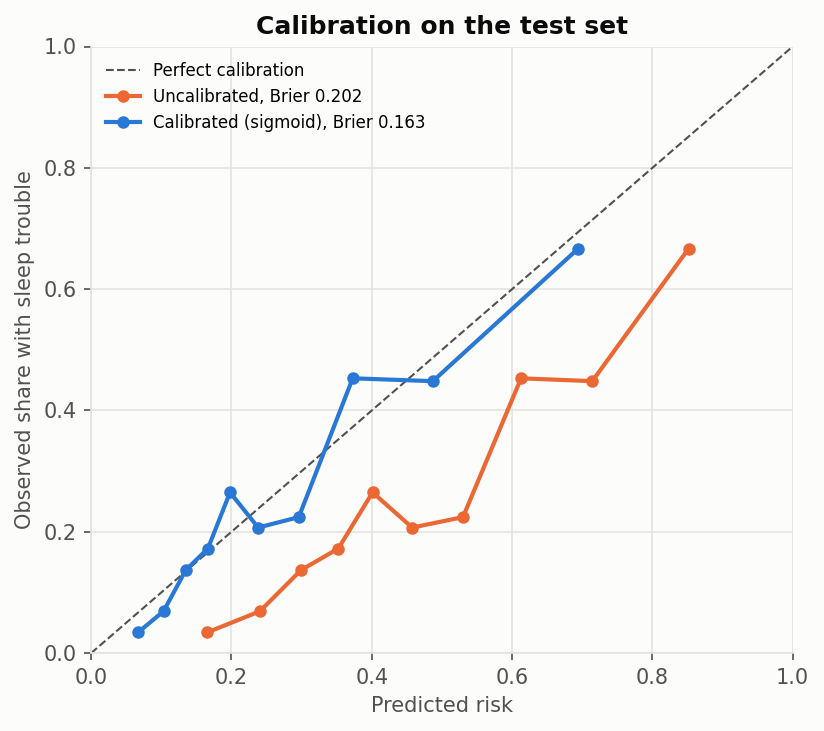
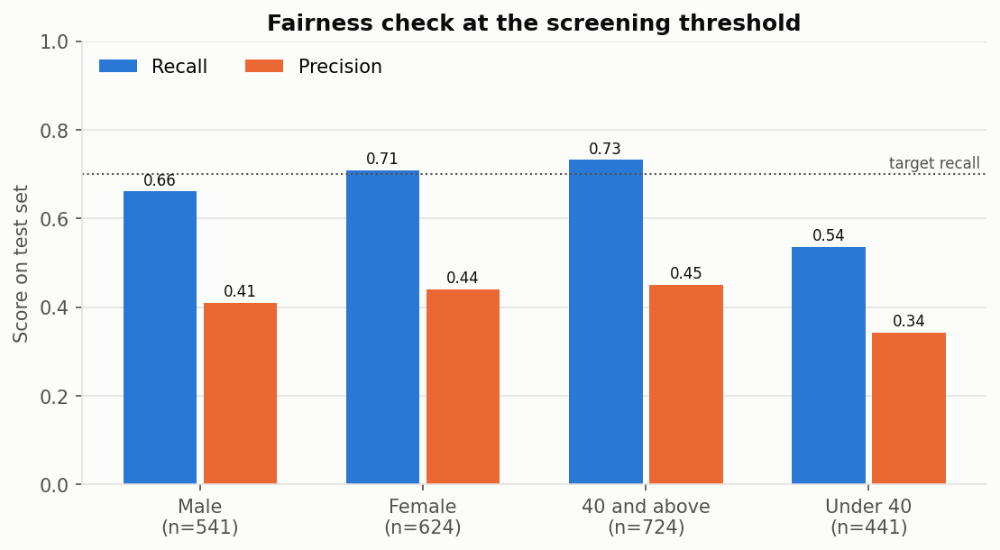
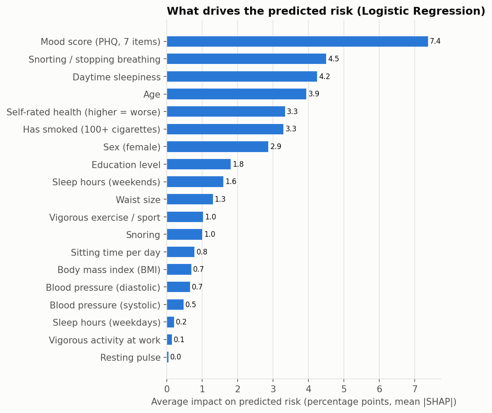
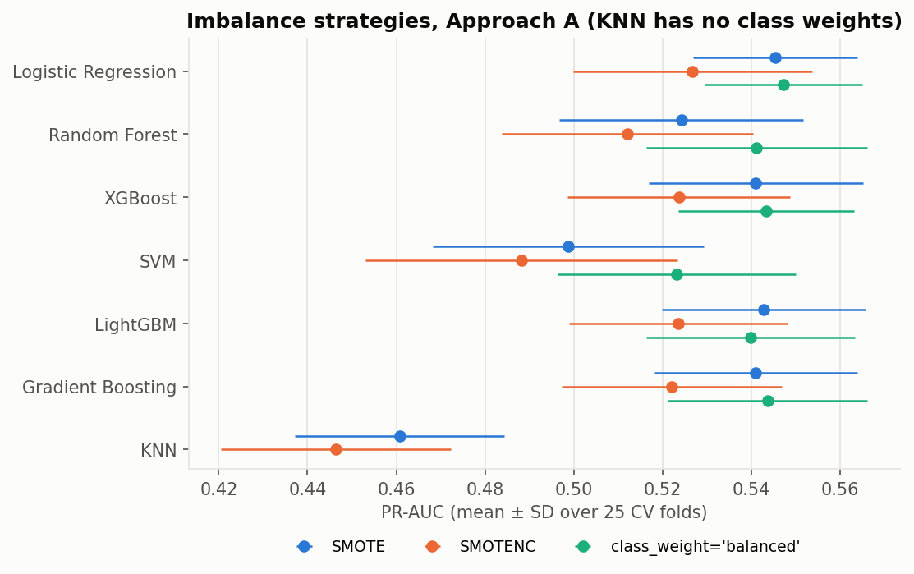

# SomnoScreen

**A 2-minute, low-cost sleep-trouble risk screener: a short questionnaire plus basic body measurements, no lab tests and no sleep study.** Built on CDC NHANES 2017–18 data, with a Streamlit web app that explains every prediction.



**Live demo:** _coming soon (Streamlit Community Cloud link)_ · <!-- TODO: add a short GIF of filling in the form -->

---

## The problem

Sleep problems are common and under-diagnosed, and the reference test (a sleep study) is expensive. Can a few questions that anyone can answer at home, plus height, weight and an optional blood-pressure reading, flag people who should talk to a doctor about their sleep?

SomnoScreen started as my undergraduate thesis, which asked a research question: **does clustering people into risk profiles before classification improve prediction?** This repository turns the thesis notebook into a tested Python package, re-checks the thesis with a stronger evaluation, and ships the final model as a web app.

## Data and target (read this first)

- **Data:** [NHANES 2017–2018](https://wwwn.cdc.gov/nchs/nhanes/continuousnhanes/default.aspx?BeginYear=2017) (US CDC health survey): demographics, examination and questionnaire files.
- **Rows:** 5,824 people (aged 16+) who answered the target question Yes or No: 1,560 Yes / 4,264 No (26.8% positive).
- **Target:** SLQ050, *"Have you ever told a doctor or other health professional that you have trouble sleeping?"* This is **self-reported**. It is **not a clinical diagnosis** of a sleep disorder, and the app says so.
- **19 low-cost features:** age, gender, education; BMI, waist, blood pressure (systolic and diastolic), pulse; snoring, snorting or stopping breathing, daytime sleepiness; vigorous work and recreational activity, smoking (100+ cigarettes), daily sitting time; weekday and weekend sleep hours, self-rated general health, and a 7-item PHQ mood score.
- **Deliberately excluded:** PHQ item DPQ030 (*"trouble falling or staying asleep"*) asks almost the same thing as the target, so including it would leak the answer.
- NHANES "refused" / "don't know" codes (7, 9, 77, 7777, 9999, …) become missing values. Missing values are filled **inside** the model pipeline from training rows only.

## Architecture



- **One source of truth for features.** `features.py` lists every input once: NHANES code, how codes map to model values, the app question, widget and whether it is optional. Training and the app both encode answers through it, so the app cannot encode an answer differently from training (no train/serve skew).
- **One saved model object.** The saved model contains the imputer, scaler, model and calibration. Blank optional answers in the app are filled exactly as in training.

## Method

1. **Phase 1: reproduce the thesis exactly.** The notebook logic was ported into `src/somnoscreen/` unchanged and re-run. **All 275 checked numbers match the original notebook** (largest difference 0.0000): see [`results/reproduction_check.csv`](results/reproduction_check.csv).
2. **Phase 2: stronger evaluation.**
   - Primary metrics **ROC-AUC** and **PR-AUC** (better than accuracy when only 27% are positive).
   - **5-fold × 5-repeat stratified CV** on the 80% training set; the 20% test set is used once at the end.
   - Imbalance handling compared: **SMOTE vs SMOTENC vs `class_weight='balanced'`**, picked by CV PR-AUC.
   - **Screening threshold** chosen on out-of-fold *training* predictions to catch 70% of "Yes" cases (`TARGET_RECALL` in `config.py`).
   - **Calibration** with `CalibratedClassifierCV`, kept only because it clearly lowers the Brier score.
   - The thesis A/B/C comparison re-run with clusters re-fitted inside every CV fold, a corrected paired t-test on the CV folds and a paired bootstrap on the test set.
   - **Fairness**: recall and precision by gender and age group at the screening threshold.
3. **Phase 4: final model + app.** Logistic Regression is refit on all 5,824 rows and served by a Streamlit app with a per-person SHAP explanation.

## Results

All numbers below are produced by the code and saved in [`results/`](results/) (tables generated by `scripts/make_results_tables.py`).

### Final model: Logistic Regression, class weights, sigmoid calibration

| Metric | Test set (at screening threshold 0.246) | CV 5×5 (training) | Majority baseline (test) |
|---|---|---|---|
| ROC-AUC | 0.758 (95% CI 0.727-0.790) | 0.757 ± 0.015 | 0.500 |
| PR-AUC | 0.530 (95% CI 0.470-0.593) | 0.547 ± 0.018 | 0.268 |
| Brier score | 0.163 | 0.163 ± 0.003 | 0.196 |
| Recall (sensitivity) | 0.689 |  | 0.000 |
| Precision | 0.427 | 0.453 ± 0.026 (at 70% recall) | 0.000 |
| F1 | 0.528 |  | 0.000 |
| Balanced accuracy | 0.676 |  | 0.500 |
| Accuracy | 0.670 |  | 0.732 |

The screener catches about 7 in 10 people who reported sleep trouble, and about 4 in 10 people it flags reported sleep trouble (base rate: 2.7 in 10). Accuracy is *below* the majority baseline on purpose: the always-"No" baseline never flags anyone, while a screener's job is to flag at-risk people, which costs some false alarms.

### Approaches A / B / C (CV, mean ± SD over 25 folds)

| Model | Imbalance | ROC-AUC A | ROC-AUC B | ROC-AUC C | PR-AUC A | PR-AUC B | PR-AUC C |
|---|---|---|---|---|---|---|---|
| Logistic Regression | class_weight | 0.757 ± 0.015 | 0.757 ± 0.015 | 0.729 ± 0.017 | 0.547 ± 0.018 | 0.547 ± 0.018 | 0.497 ± 0.030 |
| Random Forest | class_weight | 0.750 ± 0.019 | 0.749 ± 0.017 | 0.733 ± 0.019 | 0.541 ± 0.025 | 0.538 ± 0.022 | 0.517 ± 0.030 |
| XGBoost | class_weight | 0.752 ± 0.015 | 0.752 ± 0.016 | 0.720 ± 0.020 | 0.543 ± 0.020 | 0.544 ± 0.019 | 0.494 ± 0.022 |
| SVM | class_weight | 0.751 ± 0.014 | 0.750 ± 0.014 | 0.741 ± 0.014 | 0.523 ± 0.027 | 0.524 ± 0.026 | 0.522 ± 0.028 |
| LightGBM | class_weight | 0.750 ± 0.017 | 0.749 ± 0.017 | 0.711 ± 0.018 | 0.540 ± 0.023 | 0.538 ± 0.024 | 0.484 ± 0.023 |
| Gradient Boosting | class_weight | 0.752 ± 0.016 | 0.751 ± 0.016 | 0.715 ± 0.022 | 0.544 ± 0.022 | 0.543 ± 0.022 | 0.489 ± 0.024 |
| KNN | smote | 0.703 ± 0.015 | 0.702 ± 0.016 | 0.661 ± 0.019 | 0.461 ± 0.024 | 0.460 ± 0.025 | 0.400 ± 0.027 |
| Majority-class baseline | - | 0.500 |  |  | 0.268 |  |  |

A = direct classification, B = + one-hot Ward cluster label, C = a separate model per cluster. KNN cannot use class weights, so it keeps SMOTE.

### Thesis finding: clustering does not help

| Comparison (count of 7 models) | CV corrected t-test: better / worse / no difference | Test bootstrap (1,000 resamples): better / worse / no difference |
|---|---|---|
| B vs A, ROC-AUC | 0 / 0 / 7 | 0 / 0 / 7 |
| B vs A, PR-AUC | 0 / 0 / 7 | 0 / 0 / 7 |
| C vs A, ROC-AUC | 0 / 7 / 0 | 0 / 6 / 1 |
| C vs A, PR-AUC | 0 / 6 / 1 | 0 / 5 / 2 |

The thesis found that per-cluster models significantly **lowered** ROC-AUC for 6 of 7 models. Under the stronger evaluation the conclusion **still holds and is firmer**: adding the cluster label (B) changes nothing for any model, and per-cluster models (C) are worse for every model on CV. The likely reason: splitting 4,659 training rows into 4 groups gives each model less data, while the cluster information (age, BMI, symptoms) is already in the features.

### Other choices

- **Imbalance:** mean CV PR-AUC over the 6 models that support all three strategies was 0.540 for `class_weight='balanced'`, 0.532 for SMOTE and 0.516 for SMOTENC ([table](results/tables.md)).
- **Calibration:** CV Brier fell from 0.199 ± 0.005 (uncalibrated) to 0.163 ± 0.003 (sigmoid) with no loss of ROC-AUC, so the app shows calibrated probabilities.
- **Fairness (test set, screening threshold):** recall 0.662 for men vs 0.709 for women; **0.733 for people 40+ vs 0.536 for under-40s**. The model misses more younger people with sleep trouble, partly because younger people have a lower base rate (15.6% vs 33.6%). This gap is reported, not hidden.

### Key charts

| | |
|---|---|
|  |  |
|  |  |
|  |  |

The strongest drivers of predicted risk are the PHQ mood score, snorting or stopping breathing, daytime sleepiness, age and self-rated health ([`results/shap_importance.csv`](results/shap_importance.csv)).

## Limitations

- **Self-reported target.** "Ever told a doctor you had trouble sleeping" is not a diagnosed sleep disorder; some people with sleep problems never tell a doctor.
- **Survey weights not used.** NHANES oversamples some groups; without weights the results describe this sample, not the US population.
- **Cross-sectional data:** associations, not causes. A high mood score does not mean low mood *causes* sleep trouble (or the reverse).
- **US population, 2017–18 only.** The model has not been validated on other countries or years.
- **Modest accuracy.** ROC-AUC ≈ 0.76 is useful for screening but far from diagnostic.
- In the repeated-CV comparison, Approach C uses Approach A's tuned settings in every cluster (cluster numbering changes between folds). The test-set check of C tunes each cluster separately, as in the thesis, and agrees.

## How to run

```bash
# 1. Environment (macOS / Anaconda)
conda create -n somnoscreen python=3.11 -y
conda activate somnoscreen
conda install -c conda-forge llvm-openmp -y      # LightGBM needs OpenMP on macOS
pip install -r requirements-dev.txt && pip install -e .

# 2. Data: copy demographics.csv, examination.csv, questionnaire.csv into data/raw/2017-2018/
#    or rebuild them from the official CDC files (gives an identical table):
python scripts/download_nhanes.py --out data/raw/2017-2018

# 3. Pipeline
python -m somnoscreen.experiments reproduce   # Phase 1: thesis reproduction (~3 min)
python -m somnoscreen.experiments compare     # Phase 2: imbalance + A/B/C comparison (~10 min, 8 cores)
python -m somnoscreen.evaluate                # final model: calibration, threshold, test set, figures
python -m somnoscreen.train                   # fit on all rows, save models/
python scripts/make_results_tables.py         # results/tables.md
python scripts/build_analysis_notebook.py     # notebooks/analysis.ipynb

# 4. App and checks
streamlit run app/streamlit_app.py
ruff check . && pytest
```

The trained model is committed in `models/`, so the app and tests run without the data. `models/shap_background.csv` holds 100 public NHANES rows used as the SHAP baseline.

## Deploy on Streamlit Community Cloud

1. Push this repository to a public GitHub repo.
2. Go to [share.streamlit.io](https://share.streamlit.io) → **Create app** → choose the repo, branch `main`, main file `app/streamlit_app.py`.
3. Under **Advanced settings** choose **Python 3.11**, then **Deploy**.
4. Streamlit installs `requirements.txt` (pinned versions) and `packages.txt` (OpenMP for LightGBM). No data or secrets are needed.
5. Paste the app URL into the "Live demo" line at the top of this README.

## Repository layout

```
src/somnoscreen/   config, features (spec), data, pipeline, clustering, experiments, evaluate,
                   explain (SHAP), figures, train
app/               Streamlit app
models/            saved model + metadata.json + SHAP background
results/           every number (CSV / JSON), incl. reproduction_check.csv and tables.md
figures/           charts
notebooks/         thesis_original.ipynb (untouched copy) and analysis.ipynb
scripts/           CDC download, thesis-number extraction, tables, notebook builder
tests/             pytest (data decoding, pipeline, app)
```

## Citation

Centers for Disease Control and Prevention (CDC), National Center for Health Statistics (NCHS). *National Health and Nutrition Examination Survey Data, 2017–2018.* Hyattsville, MD: U.S. Department of Health and Human Services, Centers for Disease Control and Prevention. https://wwwn.cdc.gov/nchs/nhanes/

*SomnoScreen is a portfolio and research project, not a medical device. It does not diagnose any condition.*
